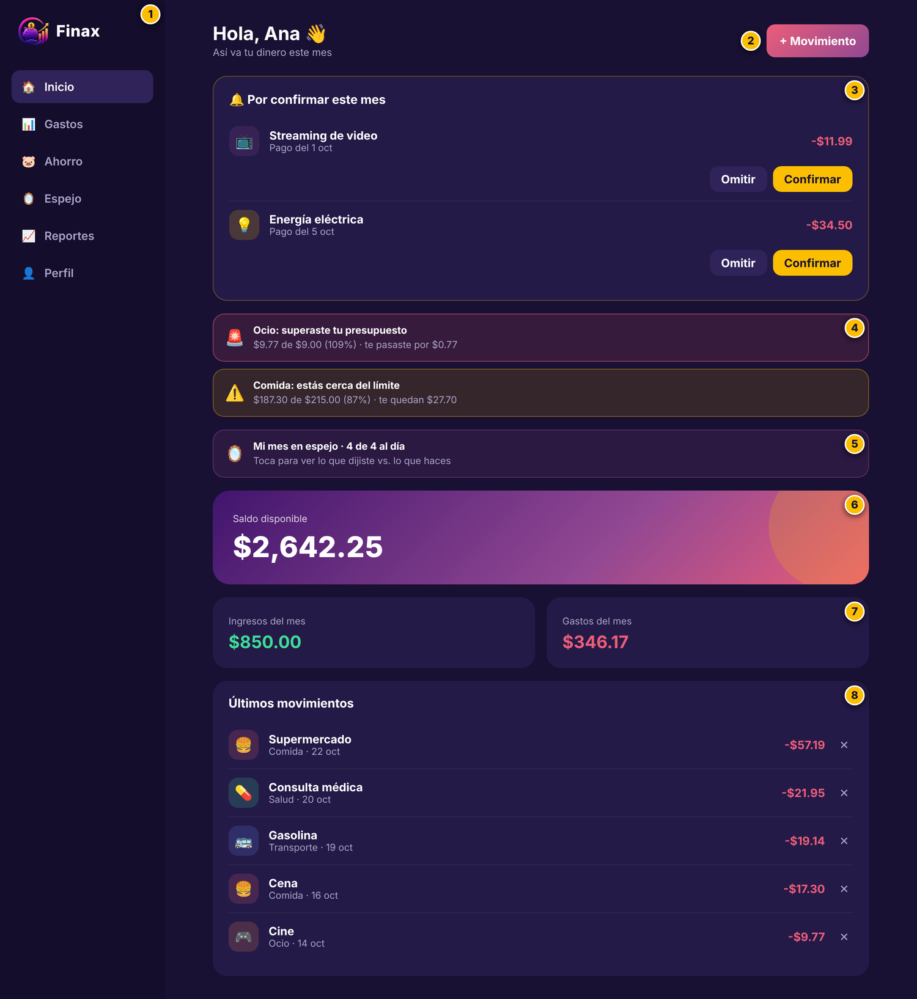
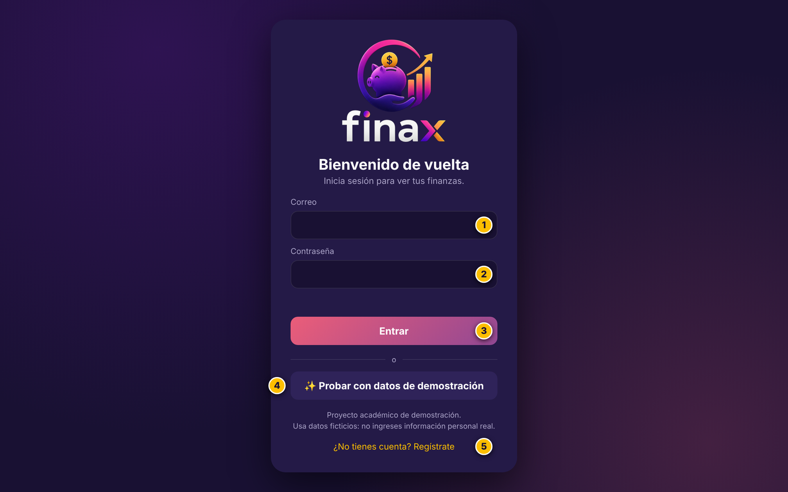
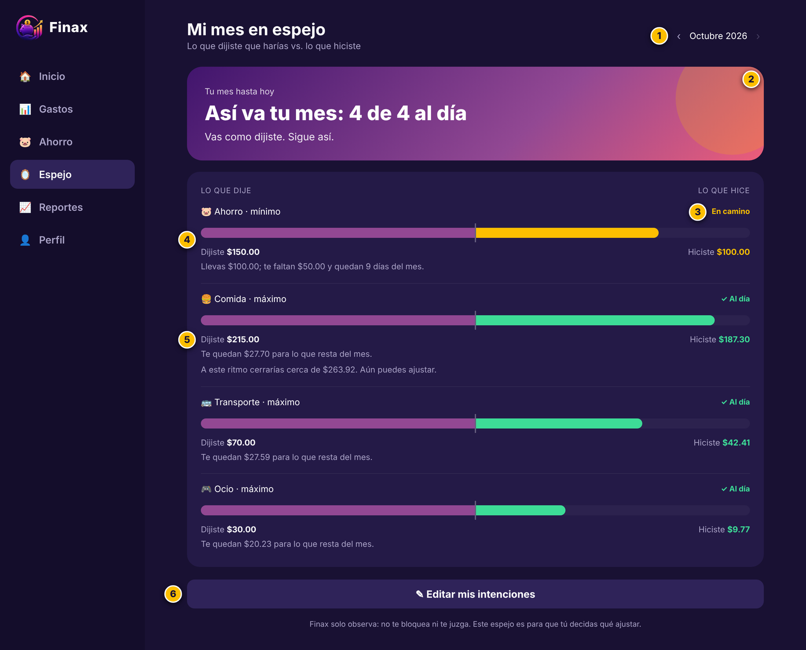
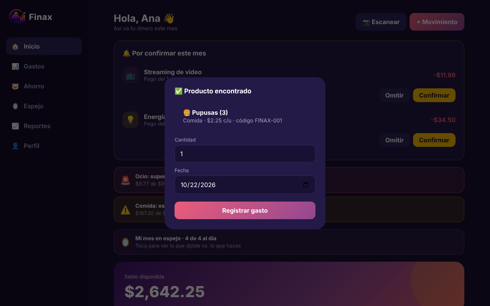
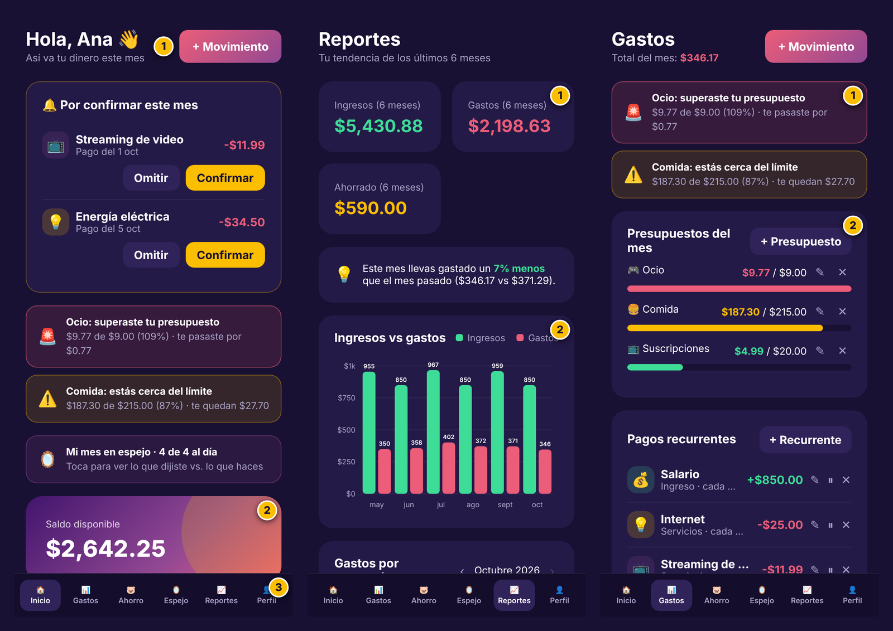
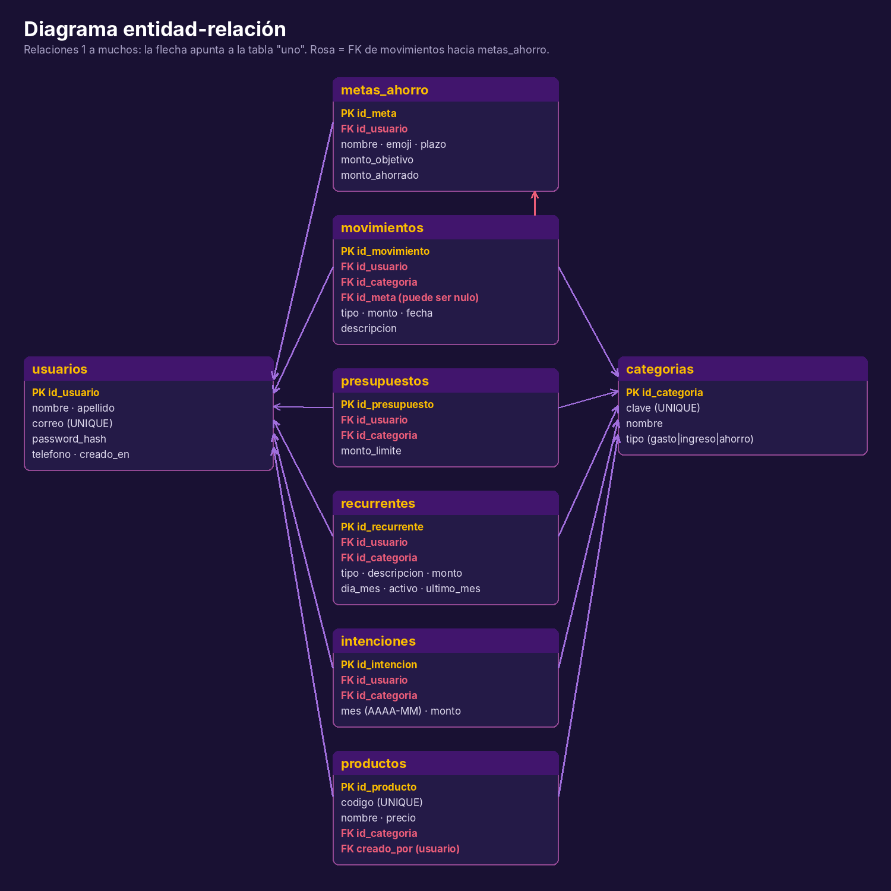

# 💜 Finax

**Control a tu dinero, construye tu futuro.**

Finax es una aplicación web de **gestión de finanzas personales**: registra ingresos y gastos, fija presupuestos con alertas, crea metas de ahorro y, con **Mi mes en espejo**, compara lo que te propusiste con lo que realmente hiciste, sin regaños. Incluye **lector de QR / código de barras** para registrar gastos escaneando un producto.

> Proyecto de fin de año. Finax no es un banco ni mueve dinero real: es una herramienta de organización personal.

<p align="center"></p>

## ✨ Funciones

| | |
|---|---|
| 🔐 **Login** | Registro e inicio de sesión validados contra MySQL; contraseñas con bcrypt |
| 💸 **CRUD** | Ingresos, gastos, metas de ahorro, presupuestos y pagos recurrentes |
| 📷 **Lector QR / barras** | Escanea un producto con la cámara (o escribe el código / lector USB) y registra el gasto |
| 🪞 **Mi mes en espejo** | Declaras intenciones al inicio del mes y al cierre ves “Cumpliste X de Y” |
| 🔔 **Alertas** | Aviso al llegar al 80 % y al superar un presupuesto |
| 📊 **Reportes** | Gráficas por categoría y por mes |

## 🧱 Tecnologías

Node.js 20 · Express · MySQL 8 (`mysql2`) · bcryptjs · JWT (cookie httpOnly) · Helmet · express-rate-limit · HTML/CSS/JS puro · html5-qrcode · Cloudflare Tunnel (opcional)

## 🖼️ Capturas

<p>


</p>
<p>


</p>

## 🚀 Guía rápida de ejecución

**Requisitos:** Git, Node.js 20+ y MySQL 8.

```bash
# 1. Clonar e instalar
git clone https://github.com/6262905-gif/finax.git
cd finax
npm install

# 2. Crear la base de datos (tablas, categorías y productos de ejemplo)
sudo mysql < database/schema.sql

# 3. Configurar variables
cp .env.example .env      # edita .env: contraseña de MySQL y JWT_SECRET

# 4. Iniciar
npm start                 # abre http://localhost:3000
```

Pulsa **“Probar con datos de demostración”** para entrar sin crear cuenta.

### Probar el lector
```bash
npm run codigos           # genera codigos-prueba.html (QR y barras de ejemplo)
```
Abre `codigos-prueba.html`, entra a Finax, toca **📷 Escanear** y apunta la cámara a un código (`FINAX-001` a `FINAX-006`). La cámara requiere **https** o `localhost`.

### Publicar para una exposición
```bash
bash publicar.sh          # túnel HTTPS temporal + QR que lleva al inicio de sesión
```

## 🗄️ Base de datos

Ocho tablas relacionadas: `usuarios`, `categorias`, `movimientos`, `metas_ahorro`, `presupuestos`, `recurrentes`, `intenciones` y `productos`. El script completo está en [`database/schema.sql`](database/schema.sql) (las migraciones para versiones anteriores, en `database/migraciones/`).



## 📁 Estructura

```
├─ server.js        API REST
├─ public/          interfaz web
├─ database/        schema.sql y migraciones
├─ docs/            manuales en PDF y capturas
├─ publicar.sh · qr.js · codigos.js
└─ .env.example     plantilla de configuración
```

## 📚 Documentación

- [Manual de usuario](docs/Manual_de_Usuario.pdf)
- [Manual técnico](docs/Manual_Tecnico.pdf)
- [Manual de marca](docs/Manual_de_Marca.pdf)

## 🔒 Seguridad

Contraseñas con bcrypt · consultas preparadas · sesión JWT httpOnly de 2 h · validación en servidor · límite de intentos · secretos solo en `.env` (excluido por `.gitignore`).

## 👤 Autor

Erick · Proyecto de fin de año
